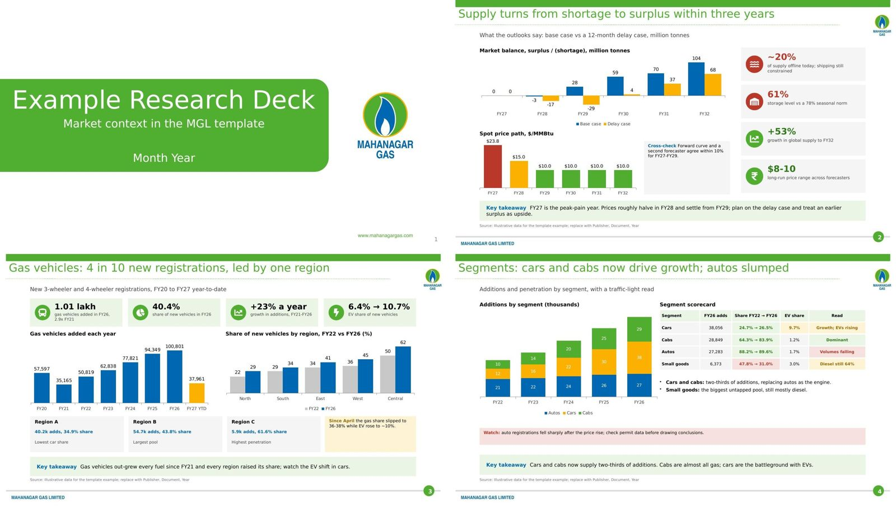

# research-deck · a Claude skill for research-backed PowerPoint decks

The research, analysis, chart-design and sources parts of the green-carousel skill, adapted for **.pptx** output in the **MGL template look** (`research-deck/template/`). The carousel brand identity, illustrations and social-caption steps are not included.



## What it does

| Step | Output |
|---|---|
| 1. Research, newest data first | Every source saved to `research/sources/` (PDFs, page snapshots, CSV) with a `Sources.md` index |
| 2. Verify | `verify_numbers.py` confirms each number appears in the saved source text |
| 3. Fact Sheet | `Fact Sheet.html`: the user ticks facts and leads, and picks autosave to disk |
| 4. Storyline | 2–3 storylines: a takeaway title, a chart type and fact IDs per slide |
| 5. Charts | `charts.py`: sankey, waterfall, bubbles, scatter, slope, dumbbell, treemap and line, as SVG or 2x PNG, with colour-blind-safe palettes |
| 6. Build | `mgl_kit.py`: MGL template slides with a takeaway title, stat cards, native charts, scorecard tables, callouts, a Key takeaway bar, a sources line and speaker notes |
| 7. Check | `check_deck.py`: missing or moved footers, old data years, shapes off the slide, overlaps |

## Install
Copy the `research-deck` folder into your skills folder (`~/.claude/skills/research-deck/`, or `C:\Users\<you>\.claude\skills\research-deck\`). Then ask for a research deck, e.g. "Research the global LNG market and make a 10-slide deck".

## Requirements
```bash
pip install -r requirements.txt
python -m playwright install chromium   # for source snapshots and chart PNGs
```
Node.js is needed for `validate_palette.js` (palette checks only).

## Folder contents
```
research-deck/
├── SKILL.md                      workflow + quality bar (read by Claude)
├── references/
│   ├── research.md               search order, newest editions, saving + verifying sources
│   ├── analysis.md               data integrity, Fact Sheet, storyline options
│   ├── chart-gallery.md          chart by the data's job, chart rules, palettes, charts.py usage
│   ├── sources.md                footer standard, speaker notes, Sources slide
│   └── template-design.md        MGL slide anatomy, components, colours, composition patterns
├── scripts/
│   ├── save_sources.py           saves every source + writes Sources.md
│   ├── verify_numbers.py         finds each claimed number in the saved files
│   ├── build_fact_sheet.py       Fact Sheet page from facts.json
│   ├── sheet_server.py           local server so Fact Sheet picks autosave
│   ├── charts.py                 SVG/PNG chart generator (no extra packages for SVG)
│   ├── chart_png.py              SVG → 2x transparent PNG (Playwright)
│   ├── validate_palette.js       colour-blind + contrast checks for a palette
│   ├── mgl_kit.py                MGL template components (python-pptx): slides, cards, charts, tables
│   ├── pptx_helpers.py           generic helpers for any other template
│   └── check_deck.py             pre-flight check of the finished .pptx
├── template/
│   ├── mgl-template.pptx         master + layouts only (no content slides)
│   └── icons/                    28 white pictograms for icon circles
├── examples/
│   └── build_example_deck.py     every component on a 7-slide example (illustrative data)
└── assets/
    ├── chart-gallery.jpg         every chart type rendered
    ├── chart-gallery-specs.json  working specs to copy
    ├── template-preview.jpg      example slides in the template
    └── fact-sheet-template.html
```

## Try it
```bash
python research-deck/examples/build_example_deck.py example.pptx
python research-deck/scripts/check_deck.py example.pptx --skip 1,7
```

## Using another template
- Open it with `pptx_helpers.py` (`Presentation("template.pptx")`). `pptx_helpers.LAYOUT` holds the title, chart and footer positions. To make a full kit like `mgl_kit.py` for it, change the colour tokens, `GRID` and the layout names.
- Pass its colours to `charts.py` with `"palette": [...]` (last = grey/other) after checking them with `validate_palette.js`.
